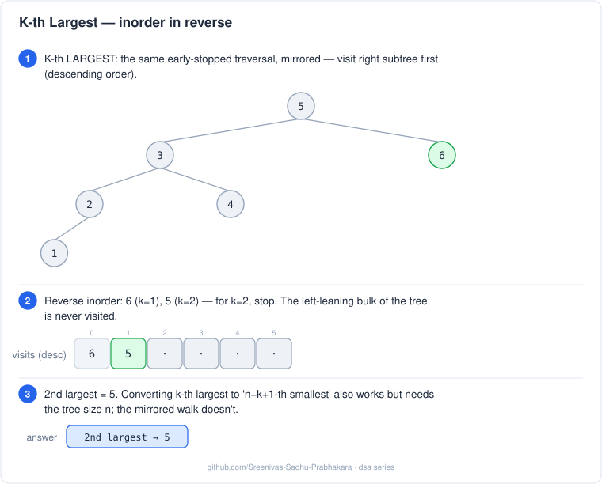

# K-th Largest in a BST

> Striver SDE Sheet 141 · Day 21 BST II — reverse inorder (right-node-left) visits a BST in descending order; stop at the k-th visit. Go, stdlib only, tested.

## Problem

The k-th *largest* value in a BST — the descending twin of #140.

## Approach

Mirror every "left" in the k-th-smallest solution to "right": sliding down the **right** spine and turning **left** after each visit walks the BST in strictly descending order, so the k-th node visited is the k-th largest. Early termination keeps the work at O(h + k), never the full tree. The naive alternative — count n first, then find the (n−k+1)-th smallest — costs a full extra traversal; the mirrored walk gets the answer in one. Recognizing that inorder has a mirror is a small structural insight that saves real work surprisingly often.

**Complexity:** O(h + k) time, O(h) stack.

## Visual walkthrough

Read the picture top to bottom — each numbered frame is one moment of the algorithm
running on this repo's test example.

## Run

    go test ./...   # verify
    go run .        # demo

---

One of 191 repos solving Striver's SDE Sheet in Go — stdlib only, one problem per repo, every solution tested. Browse the set: [`dsa-*` repos](https://github.com/Sreenivas-Sadhu-Prabhakara?tab=repositories&q=dsa-&type=source).
